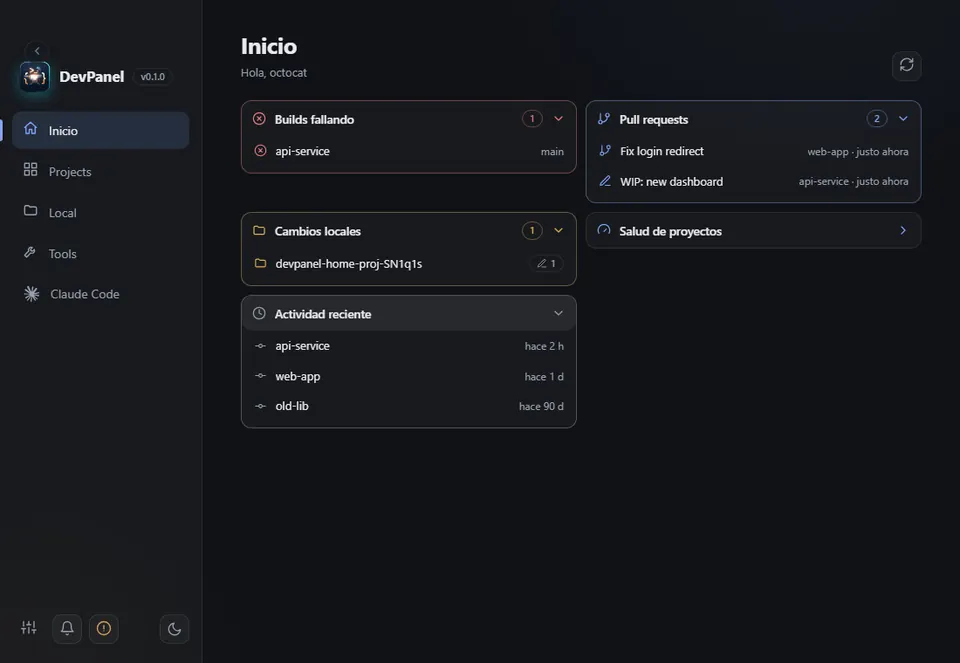
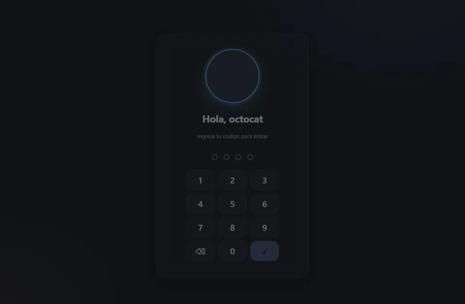
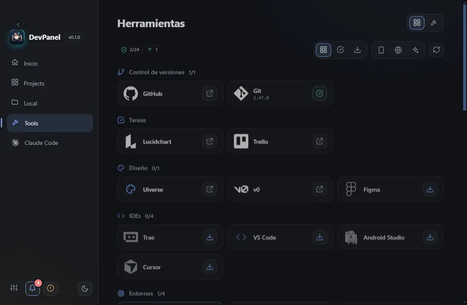

# DevPanel

**Lo que un desarrollador abre todos los días, en un solo panel.** Tus repos de GitHub, tus proyectos locales, herramientas de desarrollo y Claude Code en una app de Windows que se abre con tu rostro.

[](https://github.com/DevCat-HGS/DevPanel/releases/latest)
[](https://github.com/DevCat-HGS/DevPanel/actions/workflows/ci.yml)
[](LICENSE)




**[⬇ Descargar DevPanel para Windows](https://github.com/DevCat-HGS/DevPanel/releases/tag/installer)** · [Caso de estudio completo](https://hgsportafolio.site/devpanel/) · [Cómo se usa](docs/USAGE.md)

> **English:** DevPanel is an open-source Windows app for developers: GitHub repos, local projects, everyday tools and Claude Code in one panel, with face sign-in (no photos stored) and stable and development update channels. Built with Electron and TypeScript. [Read the case study](https://hgsportafolio.site/en/devpanel/) · [Download](https://github.com/DevCat-HGS/DevPanel/releases/tag/installer)

| Bloqueo con tu rostro o tu código | Herramientas que usas a diario, sin salir de tu equipo |
| :-- | :-- |
|  |  |

Hecha con **Electron + TypeScript**; el login facial usa un módulo en **Python** que se distribuye ya empaquetado (no hay que instalar Python). La misma interfaz corre en la **web**, solo para previsualizar durante el desarrollo.

> **Meta:** que los desarrolladores automaticen su trabajo sin salir de DevPanel. Alcance y hoja de ruta en [`docs/VISION.md`](docs/VISION.md).
>
> Documentación: [uso](docs/USAGE.md) · [privacidad](docs/PRIVACY.md) · [seguridad](docs/SECURITY.md) · [términos](docs/TERMS.md) · [licencia MIT](LICENSE). El instalador las muestra antes de instalar.

## Instalar

Descarga **`DevPanel-Installer.exe`** desde cualquier release (o desde la release [`installer`](../../releases/tag/installer)).
Es un instalador propio, una pregunta por pantalla, en español o inglés (se detecta solo; botón `ES`/`EN` arriba a la derecha):

1. Descarga la última versión y verifica su suma SHA-256 (si GitHub limita la API, la busca por las páginas públicas).
2. Te pide tu **usuario o enlace de GitHub** (te busca mientras escribes y muestra tu perfil).
3. Te hace crear tu **código de 4 dígitos** en un teclado animado.
4. Instala la versión que corresponde a tu cuenta, sin preguntar el canal (carpeta y accesos directos a elección; la descarga se puede cancelar). Si DevPanel está abierto en la bandeja, lo cierra antes.
5. Te deja **activar el reconocimiento facial** (opcional) con progreso real de las capturas.

Al abrir la app no hay que repetir nada. Después, la app pide tu rostro o tu código y entras al panel.

**Login facial:** guarda solo una huella numérica de tu rostro, cifrada con el sistema (DPAPI), nunca fotos.
Al entrar con el rostro pide un **giro de cabeza** hacia un lado al azar (anti-foto, se puede apagar en Settings).
Frena fotos y pantallas quietas o movidas sin más; no frena a un atacante con vídeo o un modelo 3D. El código de 4 dígitos es el respaldo.

## Qué incluye

- **Task Pro:** tablero de tareas por proyecto en Inicio (por hacer, en curso, hecho), con prioridad, fecha límite, avisos de vencidas y filtro por proyecto. El proyecto de una tarea abre su repo o la vista Local sin salir de la app.
- **Proyectos:** repos, commits, estado de Actions, favoritos, orden y búsqueda. Con un **token de GitHub** opcional (cifrado) ves también tus repos privados y el límite sube de 60 a 5000 consultas/hora.
- **Recomendaciones:** repos sin descripción, licencia o topics, inactivos o con muchos issues.
- **Alertas de build:** notificación del sistema cuando falla el último Actions de un repo reciente.
- **Local:** agrega carpetas de tu equipo, mira rama, cambios y último commit, haz `fetch`/`pull` y ejecuta los scripts de `npm` en una terminal integrada.
- **Herramientas:** JSON, Base64, URL, hash (SHA), UUID, JWT, fecha/Unix y regex. Todo local.
- **Entorno:** detecta qué tienes instalado (Git, Node, Python, OpenCV, Docker, VS Code, Flutter).
- **Paleta de comandos:** `Ctrl + K` para ir a cualquier vista, herramienta o proyecto.
- **Bandeja del sistema:** cerrar la ventana la deja en la bandeja; `Ctrl + Alt + D` la muestra u oculta; opción de abrir con Windows. Al ocultarse, el panel se vuelve a bloquear.
- **Idioma:** español / inglés, detectado del sistema y cambiable en Settings.
- Tema claro/oscuro y auto-update.

## Desinstalar

Desde *Configuración de Windows → Aplicaciones → DevPanel → Desinstalar*. El desinstalador pregunta qué hacer con tus datos:

| Opción | Qué borra |
| --- | --- |
| **Normal** (No) | La app, sus accesos directos y el arranque con Windows. Conserva `%APPDATA%\DevPanel`, así que al reinstalar mantienes tu PIN, rostro, token y configuración. |
| **Completa** (Sí) | Todo lo anterior, más `%APPDATA%\DevPanel` (configuración, PIN, huella del rostro, token, notas y modelos), la caché de actualizaciones y los temporales del instalador. No se puede deshacer. |

Las actualizaciones ejecutan el desinstalador en silencio y **nunca** preguntan ni borran datos; una desinstalación silenciosa (`/S`) siempre es la normal. La lógica está en [`build/installer.nsh`](build/installer.nsh).

## Ramas y releases (para quien mantiene DevPanel)

| Rama | Qué publica | Versión | Quién la recibe |
| --- | --- | --- | --- |
| `main` | **Release estable** | `v0.1.<n>` | Todos los usuarios |
| `developer` | **Release de desarrollo** (prerelease, cambios adelantados) | `v0.1.<n>-dev` | Solo `DevCat-HGS` y `GalletasU` |

Flujo de trabajo:

1. Se trabaja y se hace push en **`developer`** → GitHub Actions publica un prerelease `-dev`.
2. Cuando `developer` está probado, se promueve a **`main`** → se publica la release estable.
   - Ejecuta el workflow **Promote developer to main** (pestaña Actions) para abrir el pull request, o ábrelo a mano.
   - `main` está **protegida**: para entrar necesita que pasen los checks `Typecheck + unit tests` y `End-to-end (Electron)`. El administrador del repo puede saltarse la regla en una emergencia.

Cómo se mantienen separados los canales:

- El sufijo `-dev` en la versión es lo que los separa. `electron-updater` solo ofrece prereleases a apps que ya son `-dev`.
- Para las cuentas no autorizadas, el instalador usa `releases/latest` de GitHub, que **nunca** apunta a un prerelease: siempre instala la estable.
- La app `-dev` solo sigue prereleases si la cuenta de GitHub vinculada es `DevCat-HGS` o `GalletasU`. Cualquier otra cuenta se queda en estables.
- **Nadie elige el canal.** El instalador lo decide según la cuenta vinculada: las autorizadas reciben la de desarrollo y el resto, la estable. La lista vive en dos sitios que deben coincidir: `DEV_OWNERS` en `installer/src/main/main.ts` y `DEV_CHANNEL_OWNERS` en `src/main/updater.ts`.

> **Límite honesto:** el repo es público, así que cualquiera que sepa la URL puede descargar un prerelease a mano.
> Lo anterior controla qué **reciben y se actualizan** las apps, no quién puede descargar el archivo.
> Para un bloqueo real habría que pasar los prereleases a un repo privado (o usar la imagen Docker `:dev`, que en GHCR es privada por defecto).
>
> Además, la cuenta vinculada es el usuario que se escribe en el instalador, no un inicio de sesión: quien escriba un
> usuario autorizado recibe el canal de desarrollo. Verificarlo de verdad exigiría iniciar sesión con GitHub (OAuth).

Cada release trae sus **notas de versión**, generadas desde los commits (`feat`, `fix`, y el resto como mejoras internas).
La app las muestra una vez tras actualizar, desde el aviso de actualización y desde *Settings → Ver novedades*.

## Desarrollo

```bash
npm install
npm start              # compila y abre la app de escritorio
npm run serve:web      # vista previa web en el navegador
```

`npm start` ya limpia `ELECTRON_RUN_AS_NODE` (los terminales de VS Code lo exportan y sin eso Electron no abre ventana).
Para probar el login facial en desarrollo hace falta Python con `pip install -r python/requirements.txt`;
la app empaquetada usa `face_auth.exe` y no lo necesita.

### Pruebas

```bash
npm test               # typecheck + unit (herramientas, alertas, git, notas) + i18n
npm run test:e2e       # maneja la app real con Playwright (necesita red)
npm run test:installer # recorre las pantallas del instalador (no instala nada)
cd python && python -m unittest -q test_liveness   # lógica del giro de cabeza
```

- Las pruebas e2e usan un perfil temporal (`DEVPANEL_USER_DATA`) y fijan el idioma, así que no tocan tus datos ni dependen del idioma de la máquina.
- `tests/i18n.test.mjs` falla si agregas un texto al HTML sin su versión en inglés.
- En GitHub, [`ci.yml`](.github/workflows/ci.yml) corre todo esto (el e2e en Windows).

### Estructura

```text
src/main/        proceso principal (GitHub, updater, rostro, local, alertas, bandeja, notas)
src/preload/     puente seguro hacia la interfaz
src/renderer/    interfaz (HTML + TS, sin framework); en.ts es el diccionario inglés
python/          módulo facial (OpenCV YuNet + SFace) y desafío anti-foto
installer/       instalador propio (Electron aparte)
scripts/         copia de estáticos, arranque y generador de notas de versión
tests/           unit + i18n + e2e
docs/            guías (firma de código)
docker/          nginx para la imagen web
```

## Workflows

| Archivo | Cuándo | Qué hace |
| --- | --- | --- |
| `release.yml` | push a `main` / `developer` | Empaqueta `face_auth.exe`, compila la app, publica la release (estable o `-dev`) con sus notas e instalador |
| `installer.yml` | cambios en `installer/` | Compila `DevPanel-Installer.exe` y lo sube a la release `installer` |
| `ci.yml` | PR y push a `developer` | Typecheck, unit tests, Python y e2e en Windows |
| `docker.yml` | cambios en la interfaz | Publica la imagen web en GHCR (`:latest` desde `main`, `:dev` desde `developer`) |
| `promote.yml` | a mano | Abre el pull request `developer` → `main` |

## Web y Docker (solo desarrollo)

La versión web no tiene login facial, bandeja ni proyectos locales. Sirve para previsualizar cambios rápido.

- **Netlify:** `main` es la rama de producción y `developer` genera un *branch deploy* de vista previa (ver [`netlify.toml`](netlify.toml)).
- **Docker:** `docker compose up --build` y abre `http://localhost:8080`.
  La imagen se publica en `ghcr.io/devcat-hgs/devpanel-web` (`:dev` desde `developer`, `:latest` desde `main`).

## Pendiente / recomendaciones

- **Firma de código:** los `.exe` no están firmados, así que Windows SmartScreen avisa. Todo el cableado está listo: solo faltan los secretos `CSC_LINK` y `CSC_KEY_PASSWORD`. Ver [docs/SIGNING.md](docs/SIGNING.md) (SignPath es gratis para código abierto).
- **Repo privado para `-dev`:** si los prereleases deben ser realmente privados, muévelos a otro repo privado.
- **Antispoofing más fuerte:** el giro de cabeza frena lo básico; contra vídeo haría falta un modelo de liveness dedicado.
